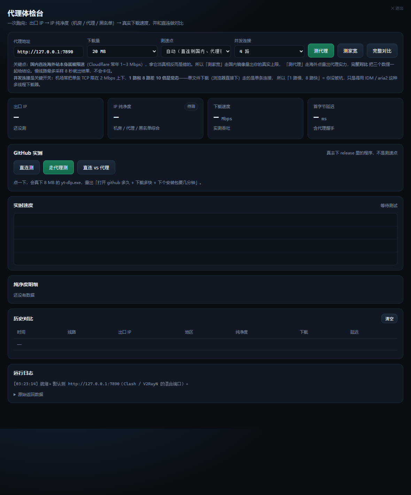

# 代理测速台 · Proxy Lab

一个跑在你电脑上的**代理体检台**：一次点下去，同时测出

- **出口 IP** 与落地地区
- **IP 纯净度**（是不是机房 IP、有没有被标成代理、有没有进垃圾黑名单）
- **真实下载速度**（走代理 / 直连，1～16 路并发）
- **访问 GitHub 并下载 release 的真实体验**（真下 yt-dlp.exe，不是测速点）



## 为什么自己做

现成的测速网站有三个毛病：

1. **国内直连海外测速站本身就被限速**（Cloudflare 常年 1~3 Mbps），拿它当基准，测出来的永远是「你家网很慢」，是错的。
2. 站点会被墙、会限流（HTTP 429）、会直接跑路。
3. 测速点和「你真正要下的东西」不是一回事——测速点跑 100 Mbps，下 GitHub 照样 200 KB/s。

所以这里：**家宽用国内镜像量**（华为云镜像实测能跑 300+ Mbps），**代理用海外点量**，GitHub 就真下 GitHub 的程序，三个数摆一起给结论。

## 用法

需要 **Node.js 18+**（无第三方依赖，不用装任何包）。

```
双击    代理测速台.lnk        # 桌面图标，静默起服务 + 打开无地址栏的应用窗口
或者    wscript launch.vbs
或者    启动.cmd             # 前台模式，能看到日志（排查问题用）
```

启动后浏览器/窗口打开 `http://127.0.0.1:8787`。界面右上角「✕ 退出」会停掉后台服务。

- 代理地址默认 `http://127.0.0.1:7890`（Clash / V2RayN 的混合端口就是 HTTP 代理，直接能用）
- 「测家宽」不经过代理；「测代理」「GitHub 实测」才走代理
- **访问 GitHub 必须挂代理**——不挂是 `ETIMEDOUT`，不是你网速的问题

## 测出来的东西怎么看

| 指标 | 含义 |
|---|---|
| 1 路 vs 8 路 | 机场常把单条 TCP 限在 2 Mbps 上下。1 路慢、8 路快 = 代理没坑你，只是单文件下载（浏览器直下）只能跑单连接 |
| 纯净度 ≥85 | 干净，可以直接用 |
| 机房 IP / hosting | Netflix、ChatGPT、银行风控都看这个，扣分最狠 |
| GitHub 换算 | 直接把 Mbps 换算成「下 24MB 的 yt-dlp 要几分钟」「下 70MB 的 Git 要几分钟」 |

## 实现要点

- 纯 Node 标准库，零依赖，`server.mjs` 一个文件，`index.html` 单页（SSE 推实时速度曲线）。
- **测速不走 `https.request`**：Node 的 `https.request` 如果跑在「已经建好的 socket」（CONNECT 隧道）上，吞吐会掉一个数量级（实测 0.02~0.05 MB/s vs 裸 socket 0.16~0.30 MB/s）。所以自己实现了 `rawOpen` / `rawPump`，直接往 TLS socket 写 HTTP 请求头、只数字节不解码 body。
- CONNECT 隧道手写，支持 `Proxy-Authorization: Basic`，支持 302 逐跳跟随（GitHub release 会跳两次到 `release-assets.githubusercontent.com`）。
- 纯净度数据源全部免费无 key：`ip-api.com`（唯一给 hosting/proxy 布尔判定的）、`ipinfo.io`、`ipwho.is`、`proxycheck.io`、`stopforumspam`。
- 扣分规则是透明的、写在界面上的：hosting −40 / 标成代理 −30 / 黑名单 −20 / 风险分高 −10 / 云厂商 ASN −15。

## 接口

| 端点 | 说明 |
|---|---|
| `GET /api/run?proxy=&mb=&target=&sec=&conns=&skipIp=1&skipPurity=1&skipSpeed=1` | SSE，事件 `stage` / `ip` / `purity` / `progress` / `done` / `error` |
| `GET /api/github?proxy=&mb=&sec=&conns=` | SSE，GitHub 网页延迟 + release 下载速度 |
| `GET /api/ping` | 存活检查 |
| `GET /api/quit` | 停服务 |

测速点：`huawei` `ustc`（国内）、`cloudflare` `vultr` `ovh`（海外）。

## 说明

- 只监听 `127.0.0.1`，不对外，别拿去当公共服务。
- 测速会真的下载数据（默认 20 MB），流量自己看着办。
- 第三方免费接口有速率限制，连续狂测可能被临时拒绝，等一会儿再测。
